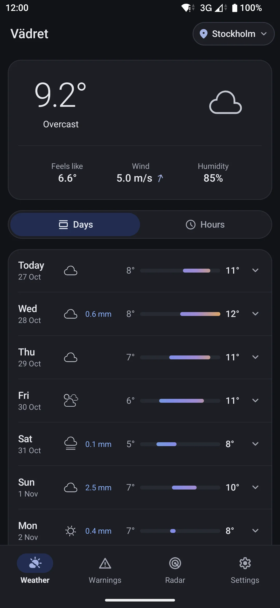
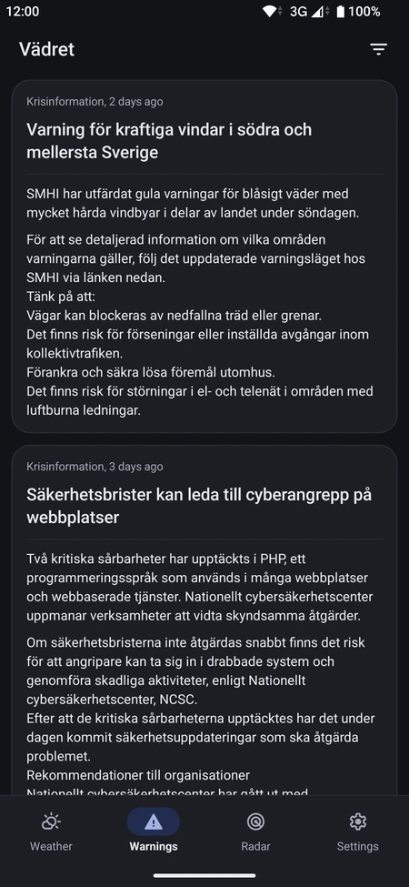
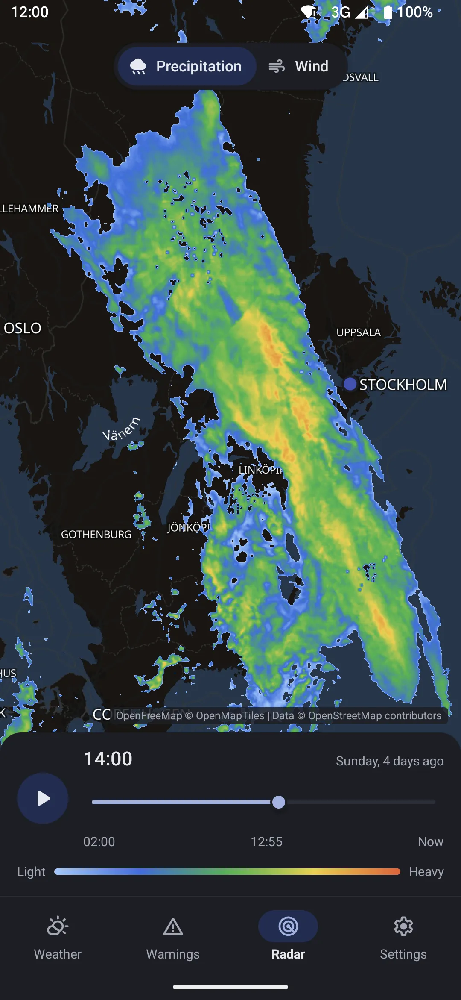
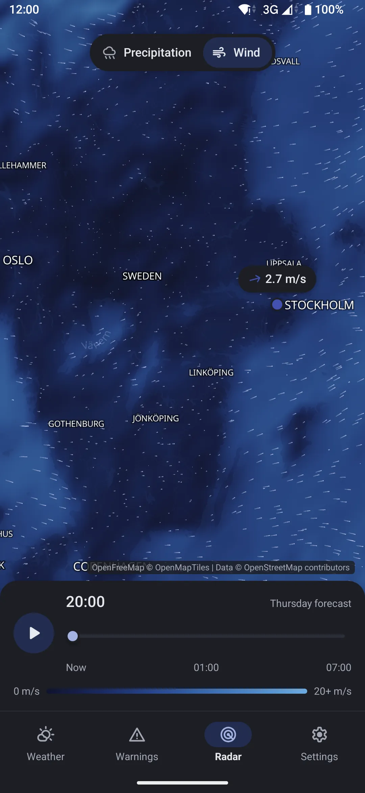
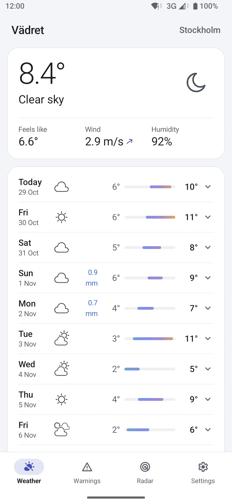
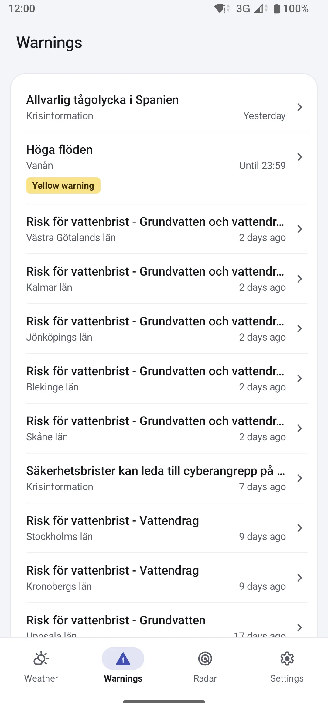
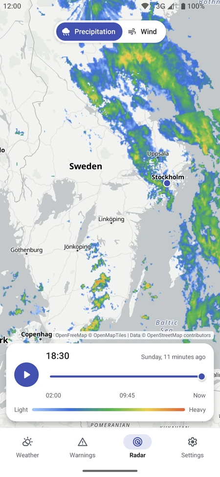
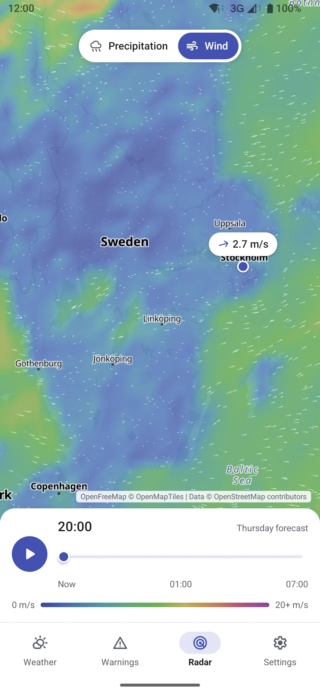

[](https://github.com/vadret/android/actions)
[](https://github.com/vadret/android/releases/)
[](https://ktlint.github.io/)
[](https://github.com/vadret/android/blob/master/LICENSE)


# Vädret
A simple weather app that uses the Swedish weather service [SMHI](https://opendata.smhi.se/) to fetch weather data, and [Krisinformation](https://www.krisinformation.se/en) for emergency information from Swedish authorities. MVI written in Kotlin Multiplatform supporting Android and iOS targets. The data is licensed under [Creative commons Erkännande 4.0 SE](https://www.smhi.se/data/om-smhis-data/villkor-for-anvandning).

[](https://f-droid.org/packages/fi.kroon.vadret/)
[](https://github.com/vadret/android/releases)

<p>
  
  
  
  
</p>

<p>
  
  
  
  
</p>

## Changelog
Changelog available [here](https://github.com/vadret/android/blob/master/androidApp/src/main/res/raw/changelog.md) in [keep-a-changelog](https://keepachangelog.com/en/1.0.0/) format.

## Architecture

This project builds on concepts from [Clean Architecture](https://8thlight.com/blog/uncle-bob/2012/08/13/the-clean-architecture.html).
The presentation layer is heavily inspired by Jake Wharton's talk on _[Managing State with RxJava](https://www.youtube.com/watch?v=0IKHxjkgop4)_.
The project also uses a modified `Either` type originally written by [Fernando Cejas](https://github.com/android10/Android-CleanArchitecture-Kotlin/blob/master/app/src/main/kotlin/com/fernandocejas/sample/core/functional/Either.kt) with some additional extensions added.

## SMHI Open Data API Docs

* [Meteorological Forecast](https://opendata.smhi.se/metfcst/snow1gv1/introduction)
* [Meteorological Analysis](https://opendata.smhi.se/metanalys/mesan2gv3/introduction)
* [Warnings](https://opendata.smhi.se/warnings/introduction)
* [Radar](https://opendata.smhi.se/radar/introduction)

## Building
This project uses [ktlint](https://github.com/pinterest/ktlint) for linting.

#### Running

```sh
./gradlew :androidApp:installFdroidLocalRelease && adb shell am start -n fi.kroon.vadret/.main.MainActivity
```

#### Running on iOS

Requires a Mac with Xcode 26. Open `iosApp/iosApp.xcodeproj` and run the `iosApp` scheme, or build from the command line:

```sh
xcodebuild -project iosApp/iosApp.xcodeproj -scheme iosApp -sdk iphonesimulator build
```

To run on a device, set your `TEAM_ID` in `iosApp/Configuration/Config.xcconfig`.

#### Testing

```sh
./gradlew test allTests
```

#### Linting
```sh
./gradlew ktlint
./gradlew ktlintFormat
```

## Contributor Guidelines
If you would like to contribute code to the project fork the project and find an issue/feature you would like to work on. Ideally check with a maintainer so you dont work on something that might be in the workings already.

Your pull request will be failed by the build server if it does not have passing unittests and lintchecks. A build can also be failed if you decrease the testing coverage.

When submitting a pull request make sure you squash
the commit(s) for that PR -- Do this so we can keep a clean
git history.

* [More information here](https://github.com/vadret/android/blob/master/CONTRIBUTING.md)

## Localization
Translations live in `core/src/main/res/values-<language>/strings.xml`. To add a language or fix a
translation, open a pull request and add your name to the `TRANSLATORS` file.

## License

	Copyright 2018 Niclas Kron

	Licensed under the Apache License, Version 2.0 (the "License");
	you may not use this file except in compliance with the License.
	You may obtain a copy of the License at

	   http://www.apache.org/licenses/LICENSE-2.0

	Unless required by applicable law or agreed to in writing, software
	distributed under the License is distributed on an "AS IS" BASIS,
	WITHOUT WARRANTIES OR CONDITIONS OF ANY KIND, either express or implied.
	See the License for the specific language governing permissions and
	limitations under the License.
